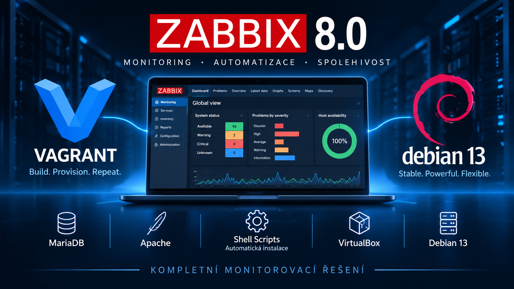
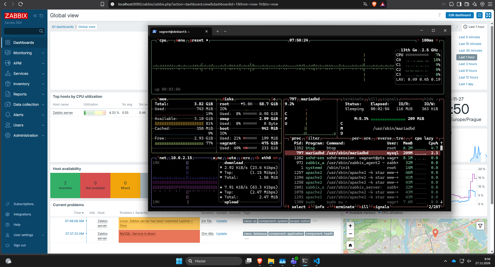
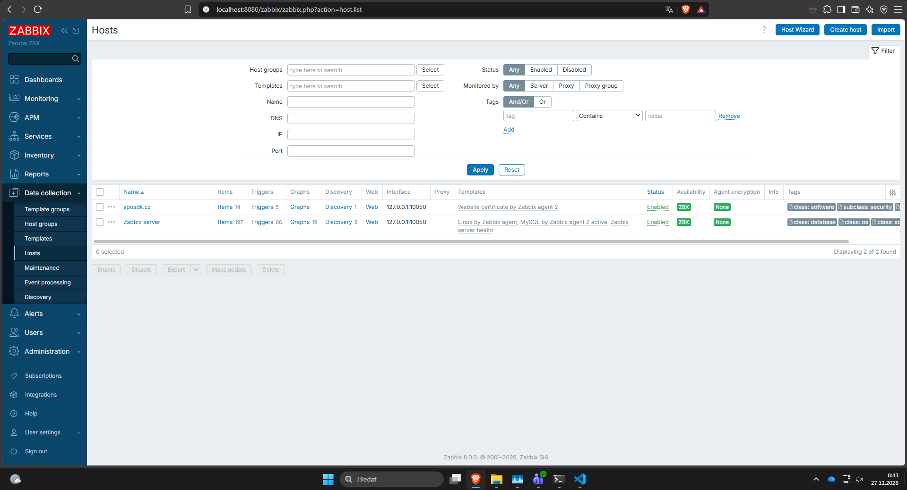
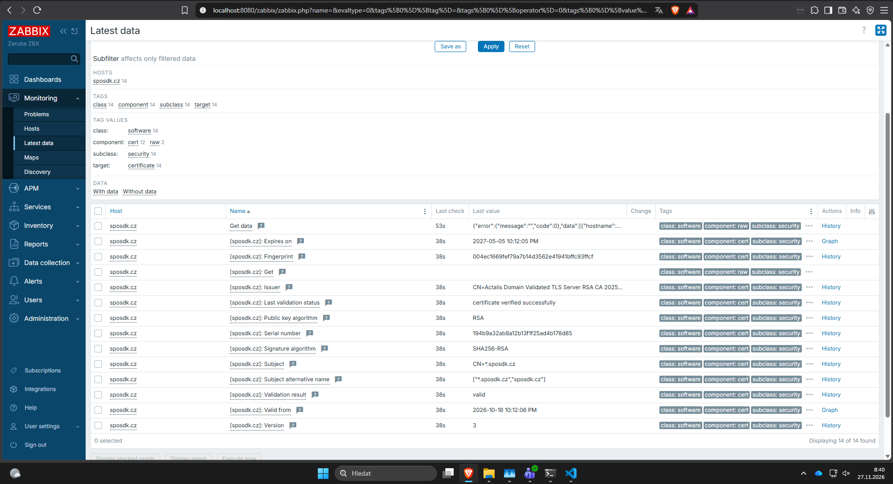
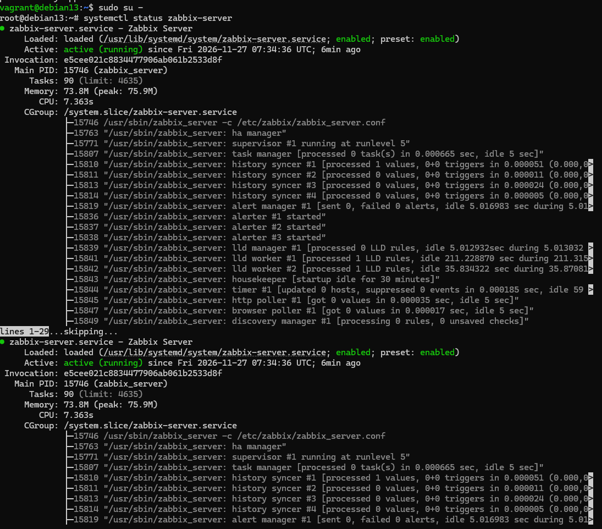

# Instalace Zabbix 8.0 LTS pomocí Vagrantu

## 1. Popis projektu

Cílem projektu bylo vytvořit automatizovanou instalaci monitorovacího systému **Zabbix 8.0 LTS** na virtuálním serveru s operačním systémem Debian 13.

Pro vytvoření virtuálního stroje byl použit nástroj Vagrant ve spolupráci s VirtualBoxem. Samotná instalace a konfigurace potřebných služeb probíhá automaticky pomocí shell skriptů.

Projekt umožňuje vytvořit funkční monitorovací server bez nutnosti ruční instalace jednotlivých komponent.


Vagrant vytvoří virtuální stroj s Debianem 13 a automaticky spustí instalační skripty.

## 2. Spuštění projektu

Nejprve naklonujeme repozitář:

```bash
git clone https://github.com/sposdknl/zarubafilip-osy-2026-zbx8-inst/
```

Přejdeme do adresáře projektu:

```bash
cd zarubafilip-osy-2026-zbx8-inst
```

Přejdeme do složky obsahující Vagrantfile:

```bash
cd Vagrant
```

Spustíme vytvoření virtuálního stroje a automatickou instalaci:

```bash
vagrant up
```

Vagrant vytvoří virtuální stroj s Debianem 13 a automaticky spustí instalační skripty.

### Další užitečné příkazy

Připojení k virtuálnímu stroji:

```bash
vagrant ssh
```

Opětovné spuštění konfigurace:

```bash
vagrant provision
```

Zastavení virtuálního stroje:

```bash
vagrant halt
```

Odstranění virtuálního stroje:

```bash
vagrant destroy
```

## 3. Skripty

Pro pohodlnou instalaci je zapotřebí si vytvořit shell skripty. Upravil jsem dané skripty z Examplu a nakonfiguroval je jako config.provision

Skripty jsou k dispozici v adresáři

## 4. Přístup do webového rozhraní

Po dokončení instalace je možné přistupovat k webovému rozhraní Zabbix z hostitelského počítače prostřednictvím webového prohlížeče.

Adresa:

```text
http://127.0.0.1:8080/zabbix
```

*Poznámka: Port musí odpovídat nastavení přesměrování v souboru Vagrantfile.*

Po přihlášení je dostupné administrační rozhraní Zabbix, ve kterém lze sledovat stav serverů, monitorovací data a jednotlivé metriky.

## 5. Ověření funkčnosti

Po dokončení instalace byla ověřena funkčnost jednotlivých částí systému:

- Dostupnost webového rozhraní Zabbix.
- Funkčnost Zabbix Serveru.
- Komunikace se Zabbix Agent 2.
- Monitorování lokálního serveru Debian 13.
- Zobrazení aktuálních hodnot v sekci Latest data.
- Monitorování TLS/SSL certifikátu domény `sposdk.cz`.
- Stav služeb MariaDB, Apache, Zabbix Server a Zabbix Agent 2.

## 6. Dokumentace – screenshoty

V adresáři `Images/` jsou uloženy screenshoty dokumentující průběh realizace projektu a výslednou funkčnost systému.

### 6.1 Webové rozhraní Zabbix

Screenshot zachycuje úspěšně spuštěné webové rozhraní Zabbix s vlastním názvem serveru.



### 6.2 Monitorování hostů

Screenshot zobrazuje přidané hostitele.



### 6.3 Monitorování SSL certifikátu

Screenshot dokumentuje monitorování TLS/SSL certifikátu webové stránky `sposdk.cz`.



### 6.4 Ověření běhu služeb

Screenshot zachycuje ověření stavu jednotlivých služeb potřebných pro správný chod systému.



## 7. Závěr

V rámci projektu byla vytvořena automatizovaná instalace monitorovacího systému Zabbix 8.0 LTS na virtuálním serveru Debian 13.

Pomocí nástrojů Vagrant a VirtualBox je možné vytvořit virtuální prostředí a automaticky provést instalaci potřebných komponent prostřednictvím shell skriptů.

Výsledkem je připravený monitorovací server s databází MariaDB, webovým rozhraním, Zabbix Agent 2 a možností monitorování lokálního serveru i SSL certifikátů.

Při vypracování README.md byla použita AI (Free verze ChatGPT).